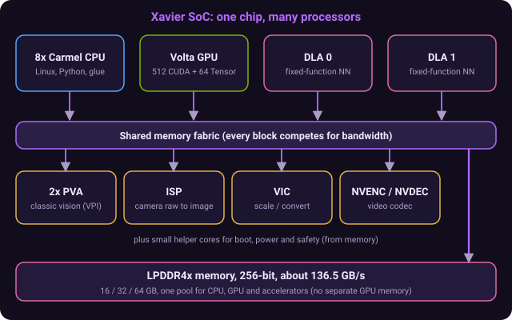
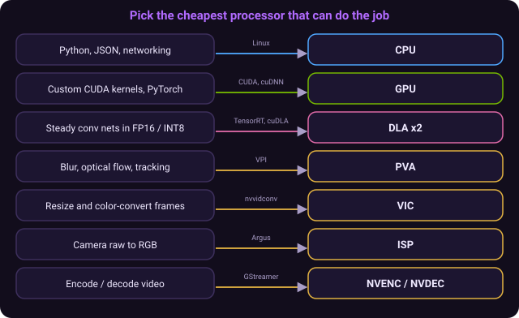
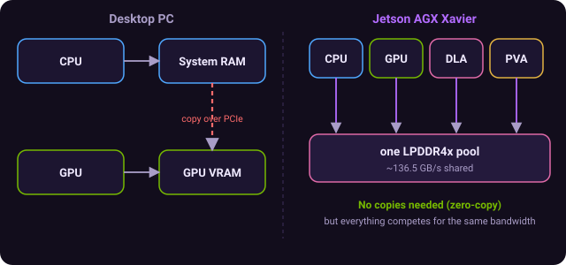
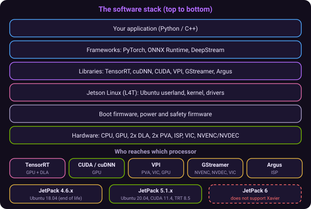
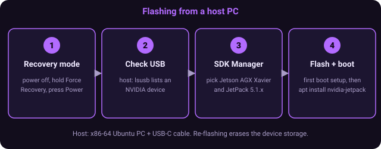
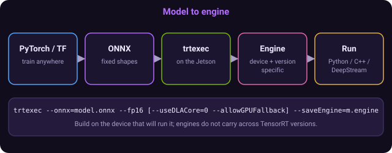
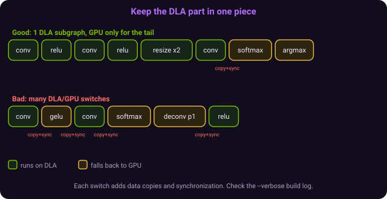
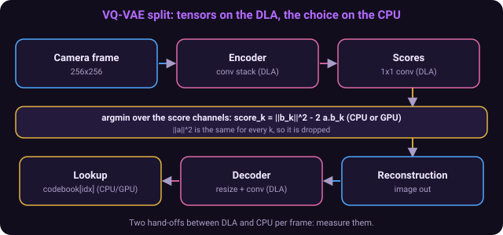
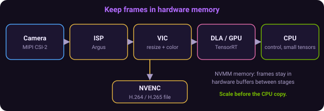
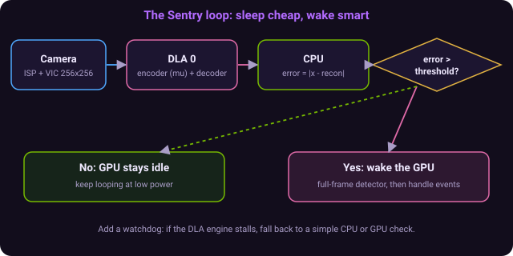

# NVIDIA Jetson AGX Xavier: Hardware and Software Tutorial

## 0. Read me first

### Summary
The Jetson AGX Xavier is a small computer built around one chip (the Xavier SoC) that contains several different processors, each good at a different kind of work, all sharing one pool of memory. This tutorial explains each processor, how to power and flash the board, which software drives which processor, and how to design models that make good use of all of them. Every chapter has the same four parts: Summary, Key points, Examples, and Check yourself. A glossary and a command cheat sheet are near the end.

### Key points
- Read chapters 1 to 4 for the hardware, 5 to 7 to get the board running, 8 to 10 for compute, 11 to 15 for design and pipelines.
- Commands are shown for a Jetson running Linux (JetPack). Lines starting with `$` are typed at the Jetson's shell; `#` lines are comments.
- Numbers are given as ranges or "about" where they depend on your exact module, power mode or software version.
- Where a statement is not verified against NVIDIA documentation, it is marked (from memory) and listed in chapter 21.
- The companion interactive tutorial (a webxdc app and an Android APK) is generated from this file, so they always agree. Teacher, the avatar in the app, reads any chapter aloud.
- Chapter 22 holds four concept maps: relationship diagrams that show how the ideas connect. Tap a node in the app to jump to its chapter.

### Examples
```bash
# The first three commands to run on any Jetson, to learn what you have
$ cat /etc/nv_tegra_release        # the Jetson Linux (L4T) release
$ sudo nvpmodel -q                 # the current power mode
$ tegrastats                       # live CPU/GPU/memory load (Ctrl+C to stop)
```

### Check yourself
- Q: What is the one idea that explains why the Xavier has so many processors? | A: Different workloads (general code, parallel math, fixed neural-net layers, classic vision, video) each run best on a specialized block, so the chip includes one of each and shares memory between them.
- Q: Which chapters help you get the board running? | A: Chapters 5, 6 and 7 (software stack, setup and flashing, monitoring).

## 1. The big picture

### Summary
The AGX Xavier is NVIDIA's 2018-generation edge-AI module. It is a system-on-module (SoM): the Xavier SoC, memory, flash storage and power management on a small board that plugs into a carrier board through a 699-pin connector. It targets robots, drones, cameras and vehicles that must run several neural networks at low power. It was sold as 16 GB, 32 GB and 64 GB modules and an Industrial version, with a developer kit (module plus carrier board, fan heatsink and power supply) for development.

### Key points
- Module: the Xavier SoC plus memory, eMMC storage and power circuitry, about 100 mm by 87 mm.
- Carrier board: breaks out the connectors (USB, Ethernet, display, camera, PCIe, M.2, GPIO header). The developer kit includes one; products use custom ones.
- Headline figure: up to 32 TOPS INT8 combined across GPU and the two DLAs, in 10 to 30 W modes.
- Variants: AGX Xavier (16/32 GB), 64 GB, and Industrial (lower clocks, ECC memory, wider temperature range).
- It is end-of-life as a new purchase (chapter 18), but it remains widely deployed and well documented.
- It is not a PC: there is no BIOS setup menu for boot order; you flash images onto it from a host PC.

### Examples
```text
Jetson AGX Xavier family at a glance (typical)
  GPU            Volta, 512 CUDA cores, 64 Tensor Cores
  CPU            8-core NVIDIA Carmel (Arm v8.2)
  DLA            2 x NVDLA
  PVA            2 x PVA v1
  Memory         16 / 32 / 64 GB LPDDR4x, 256-bit, ~136.5 GB/s
  Storage        32 GB eMMC 5.1 on the module (64 GB on Industrial)
  Power modes    10 W, 15 W, 30 W (plus MAXN on dev kits)
```

### Check yourself
- Q: What is the difference between the module and the developer kit? | A: The module is the compute board; the developer kit adds a carrier board with connectors, a heatsink/fan and a power supply.
- Q: What is the 32 TOPS number made of? | A: Roughly 22 TOPS from the GPU plus about 10 TOPS from the two DLAs, in INT8.

## 2. Hardware tour: the processors

### Summary
Inside the Xavier SoC are a CPU cluster, a GPU, two deep-learning accelerators (DLAs), two programmable vision accelerators (PVAs), fixed-function image and video blocks, and several small helper cores. You choose which block runs each part of your application; the operating system does not do this automatically for neural networks.

### Key points
- CPU: 8 NVIDIA Carmel cores (Arm v8.2, 64-bit), arranged as four dual-core clusters, with about 8 MB of L2 and 4 MB of L3 cache in total. Runs Linux, your Python, networking and orchestration.
- GPU: NVIDIA Volta with 8 streaming multiprocessors (512 CUDA cores) and 64 Tensor Cores. Compute capability 7.2 (`sm_72`). General CUDA, plus fast FP16/INT8 deep learning. Maximum clock about 1377 MHz (Industrial: about 1211 MHz).
- DLA (NVDLA): two fixed-function inference engines. They run supported neural-network layers (convolution, pooling, activation, and so on) in FP16 or INT8 with low power, leaving the GPU free. They are driven through TensorRT (or cuDLA), not CUDA.
- PVA: two Programmable Vision Accelerators, vector (VLIW) processors for classic computer vision such as filtering, optical flow and feature tracking. They are not for neural networks. Used through VPI.
- ISP: image signal processor that turns raw camera sensor data into usable images (debayer, denoise, white balance), reached through Argus.
- Video: hardware H.264/H.265/VP9 encoder (NVENC) and decoder (NVDEC), reached through GStreamer or the Multimedia API.
- VIC: video image compositor for fast scaling, color conversion and cropping with no GPU cost.
- Helper cores (from memory): Arm Cortex-R5 cores for boot and power management (BPMP), a safety cluster running in lockstep, and an audio processing engine. You rarely touch these directly.

### Examples




```text
Which processor for which job?

  Parse JSON, run Python, networking           -> CPU
  Custom CUDA kernel, PyTorch model            -> GPU
  Steady-state conv net (detector, encoder)    -> DLA (via TensorRT)
  Gaussian blur, optical flow, stereo          -> PVA (via VPI) or GPU
  Decode a 4K video stream                     -> NVDEC
  Resize and convert color of every frame      -> VIC (nvvidconv)
  Camera raw to RGB                            -> ISP (Argus)
```

```bash
# See the CPU cores and the GPU from software
$ lscpu | head -20
$ /usr/local/cuda/extras/demo_suite/deviceQuery   # if the CUDA samples are installed
```

### Check yourself
- Q: Can you program the DLA with CUDA? | A: No. The DLA is used through TensorRT (or cuDLA); CUDA targets the GPU.
- Q: What is the PVA for? | A: Classic vision algorithms (filters, flow, tracking) at low power, through VPI. It does not run neural networks.
- Q: What compute capability does the Xavier GPU have? | A: 7.2, compiled with `-arch=sm_72`.

## 3. Memory, I/O and the carrier board

### Summary
All the processors share one pool of LPDDR4x memory. This unified memory removes copies between CPU and GPU (zero-copy is possible) but means every block competes for the same bandwidth. The module exposes cameras, PCIe, USB, display and general I/O through its connector; a carrier board turns these into physical ports.

### Key points
- Memory: 256-bit LPDDR4x at about 136.5 GB/s, shared by CPU, GPU, DLAs, PVAs and media blocks. There is no separate "GPU memory"; `nvidia-smi` memory figures do not apply the way they do on a desktop.
- Memory bandwidth, not compute, is usually the bottleneck when you run everything at once.
- Storage: 32 GB eMMC on the module (64 GB Industrial). The developer kit also has an M.2 NVMe slot; for real work, boot or store models on NVMe.
- Camera: up to 6 cameras directly (36 through virtual channels) on 16 MIPI CSI-2 lanes.
- PCIe: up to 8 lanes of Gen 4 (on the dev kit, a PCIe slot plus M.2 slots, from memory).
- USB 3.1, gigabit Ethernet, three display outputs (DP 1.2 or HDMI 2.0), UART, SPI, I2C, I2S, CAN, GPIO.
- Dev kit extras (from memory; confirm in the Developer Kit User Guide): 40-pin expansion header, 19 V power input, a USB-C port used for flashing, Wi-Fi/Bluetooth card.

### Examples


```bash
$ free -h                      # total and used RAM (this is also the "GPU memory")
$ lsblk                        # eMMC (mmcblk0) and NVMe (nvme0n1) devices
$ df -h /                      # root filesystem space
$ lsusb                        # USB devices
$ lspci                        # PCIe devices (NVMe, Wi-Fi, ...)
```

```cuda
// Zero-copy-style memory: one allocation visible to both CPU and GPU
float *x;
cudaMallocManaged(&x, n * sizeof(float));   // unified memory
for (int i = 0; i < n; i++) x[i] = i;       // CPU writes
kernel<<<blocks, threads>>>(x, n);          // GPU uses the same buffer
cudaDeviceSynchronize();                    // wait before the CPU reads again
```

### Check yourself
- Q: Why can the CPU and GPU share a buffer with no copy on a Jetson? | A: They are on the same SoC and use the same physical memory.
- Q: What usually limits a Jetson that is running many models at once? | A: Shared memory bandwidth.

## 4. Power, clocks and thermals

### Summary
The module is designed for 10 W, 15 W and 30 W budgets. A power mode (set with `nvpmodel`) chooses how many CPU cores are online and the maximum CPU, GPU, DLA and memory clocks. `jetson_clocks` pins clocks at their maximum within the mode. Heat is managed by a heatsink and fan; if temperatures rise, the system throttles clocks.

### Key points
- `sudo nvpmodel -q` shows the current mode; `sudo nvpmodel -m <id>` sets it. Mode ids and names vary by board and release: list yours with `sudo nvpmodel -q --verbose` and read `/etc/nvpmodel.conf`.
- Typical AGX Xavier modes (from memory): MAXN (unrestricted), 10 W, 15 W, several 30 W variants with different numbers of enabled CPU cores, and a 15 W desktop mode.
- `sudo jetson_clocks` locks clocks high for stable benchmarks; `sudo jetson_clocks --show` prints the state; `--store` and `--restore` save and restore settings.
- `sudo jetson_clocks --fan` forces the fan to maximum.
- Always benchmark in a fixed power mode with clocks locked, or your numbers will move around.
- The dev kit power input is about 19 V; a weak supply causes brownouts and throttling under load.

### Examples
```bash
$ sudo nvpmodel -q                    # e.g. "NV Power Mode: MODE_15W"
$ sudo nvpmodel -m 0                  # MAXN, if your table says mode 0 is MAXN
$ sudo jetson_clocks                  # lock clocks to the maximum for this mode
$ sudo jetson_clocks --show           # confirm
$ cat /sys/devices/virtual/thermal/thermal_zone*/temp   # temperatures in milli-degrees C
```

```text
Choosing a mode
  Battery or passive cooling, modest models  -> 10 W / 15 W
  Fixed-power vehicle or robot, multiple nets -> 30 W
  Benchmarking and development                -> MAXN + jetson_clocks, then re-test at your real mode
```

### Check yourself
- Q: What does `jetson_clocks` do? | A: Locks the CPU, GPU, memory and accelerator clocks at the maximum allowed by the current power mode.
- Q: Why benchmark with clocks locked? | A: Dynamic frequency scaling makes timings vary from run to run.

## 5. The software stack and JetPack versions

### Summary
NVIDIA ships Jetson software as JetPack, a bundle that contains Jetson Linux (L4T: an Ubuntu-based OS, kernel and drivers) plus CUDA, cuDNN, TensorRT, VPI and multimedia libraries. Your JetPack version is fixed by your hardware generation. The AGX Xavier works with JetPack 4.6.x and JetPack 5.x; it does not work with JetPack 6.

### Key points
- JetPack 4.6.x (from memory): L4T 32.7.x, Ubuntu 18.04, CUDA 10.2, TensorRT 8.2. This line has reached end of life.
- JetPack 5.1 (checked in NVIDIA release notes): Jetson Linux 35.2.1, Linux kernel 5.10, Ubuntu 20.04 root filesystem, UEFI bootloader, CUDA 11.4, TensorRT 8.5.2, cuDNN 8.6.0, VPI 2.2. It supports the AGX Xavier series.
- NVIDIA staff say JetPack 6 does not support the Xavier series (forum thread, cited in chapter 21). JetPack 5.1.x is the latest software for AGX Xavier; one NVIDIA forum table lists 5.1.4 as the latest sustaining release.
- Consequence: you cannot update TensorRT or CUDA freely. Newer library versions require building from source or using containers built for JetPack 5.
- The layers, bottom to top: hardware, bootloader and firmware, Linux kernel and drivers (L4T), CUDA/cuDNN/TensorRT/VPI/multimedia libraries, frameworks and your application.
- Which library reaches which processor: CPU (Linux), GPU (CUDA, cuDNN, TensorRT), DLA (TensorRT, cuDLA), PVA and VIC (VPI), ISP (Argus), NVENC/NVDEC (GStreamer, Multimedia API), Tensor Cores (cuDNN, TensorRT, cuBLAS).

### Examples


```bash
$ cat /etc/nv_tegra_release                      # L4T release and revision
$ sudo apt-cache show nvidia-jetpack | grep -i version   # JetPack meta-package version
$ dpkg -l | grep -E "tensorrt|cuda-toolkit|libcudnn|vpi"   # installed library versions
$ python3 -c "import tensorrt; print(tensorrt.__version__)"
$ nvcc --version      # may need: export PATH=/usr/local/cuda/bin:$PATH
```

```text
The stack (top to bottom)
  Your application (Python / C++)
  Frameworks: PyTorch, ONNX Runtime, DeepStream
  Libraries:  TensorRT  cuDNN  CUDA  VPI  GStreamer  Argus
  Jetson Linux (L4T): Ubuntu userland + kernel + drivers
  Boot firmware: bootloader, BPMP, safety firmware
  Hardware: CPU  GPU  DLA x2  PVA x2  ISP  NVENC/NVDEC  VIC
```

### Check yourself
- Q: Can you run JetPack 6 on an AGX Xavier? | A: No. JetPack 6 targets Orin; Xavier stops at JetPack 5.x.
- Q: Which library do you use to put a model on the DLA? | A: TensorRT (or cuDLA for standalone loadables).

## 6. Setup: flashing and first boot

### Summary
You do not install an OS from a USB stick. You connect the Jetson to a Linux host PC over USB in recovery mode and flash JetPack with NVIDIA SDK Manager. After the first boot you complete the Ubuntu setup and install the optional JetPack components.

### Key points
- Host: an x86-64 Ubuntu PC (the version must be supported by your SDK Manager release; check the SDK Manager download page). A virtual machine is possible but less reliable for USB.
- Connect the host to the Jetson's flashing USB-C port (the dev kit port next to the buttons; confirm in the user guide) with the cable that came in the box.
- Recovery mode (dev kit, from memory): power off; hold the Force Recovery button; press and release Power; release Force Recovery after a couple of seconds. On the host, `lsusb` should list an NVIDIA device.
- In SDK Manager choose the product (Jetson AGX Xavier), the JetPack version (5.1.x recommended unless a project needs 4.6), the target storage (eMMC or NVMe), and let it flash and install components.
- First boot: accept the license, create a user, set the network. Then install any components that were skipped (`sudo apt install nvidia-jetpack`).
- Keep a spare copy of any images you customize; re-flashing wipes the device storage.
- Booting from NVMe is much faster and larger than eMMC; many people flash the OS to NVMe and keep eMMC as a backup.

### Examples


```bash
# On the host PC, after putting the Jetson in recovery mode:
$ lsusb | grep -i nvidia
Bus 001 Device 012: ID 0955:7019 NVIDIA Corp.      # id may differ by module; any NVIDIA device is a good sign

# Then run SDK Manager (GUI) and pick: Jetson AGX Xavier -> JetPack 5.1.x -> flash
$ sdkmanager
```

```bash
# On the Jetson after first boot
$ sudo apt update
$ sudo apt install nvidia-jetpack          # CUDA, cuDNN, TensorRT, VPI, samples...
$ sudo apt install python3-pip
$ sudo pip3 install -U jetson-stats        # provides jtop
$ sudo reboot
```

### Check yourself
- Q: What tool flashes the Jetson? | A: NVIDIA SDK Manager, run on a Linux host PC.
- Q: How can you confirm the Jetson is in recovery mode? | A: `lsusb` on the host lists an NVIDIA USB device.

## 7. Monitoring and system tools

### Summary
Because so many blocks share the chip, you need to see what is busy. `tegrastats` prints a line of CPU, GPU, memory and temperature data; `jtop` shows the same in a friendly full-screen view; `nvpmodel` and `jetson_clocks` control power; `htop` and `top` show processes.

### Key points
- `tegrastats` reports RAM and swap, per-core CPU load and frequency, `GR3D_FREQ` (GPU load and clock), `EMC_FREQ` (memory controller load, a proxy for bandwidth pressure), and temperatures and power rails. On some releases it also lists the DLA, NVENC and NVDEC clocks.
- `jtop` (from the `jetson-stats` package) gives pages for CPU, GPU, memory, engines (DLA/NVENC/NVDEC), power and controls.
- `sudo tegrastats --interval 500` samples every 500 ms; `--logfile out.txt` writes to a file.
- `nvidia-smi` is limited on Jetson; use `tegrastats` or `jtop` instead.
- Check the GPU is really being used: watch `GR3D_FREQ` rise while your model runs.
- To see DLA use, watch the engine view in `jtop` (if available) or time your engine with `trtexec`.

### Examples
```bash
$ tegrastats
RAM 3011/31920MB (lfb 6811x4MB) SWAP 0/15960MB CPU [12%@2265,5%@2265,...] EMC_FREQ 9%@2133 GR3D_FREQ 0%@1377 ... Tdiode@44C ...
# (line abbreviated; fields vary by release)

$ sudo tegrastats --interval 1000 --logfile run1.txt &
$ python3 my_model.py
$ kill %1                                  # then inspect run1.txt
```

```python
# Quick programmatic stats with jetson-stats
from jtop import jtop
with jtop() as jetson:
    while jetson.ok():
        print(jetson.stats)     # dict of CPU/GPU/RAM/temperatures
        break
```

### Check yourself
- Q: Which `tegrastats` field tells you how busy the GPU is? | A: `GR3D_FREQ`.
- Q: Which field hints at memory bandwidth pressure? | A: `EMC_FREQ` (memory controller utilization).

## 8. GPU programming with CUDA

### Summary
The Xavier GPU runs ordinary CUDA code. You write kernels executed by thousands of threads, organized into blocks and a grid, and compile with `nvcc` for compute capability 7.2. Because memory is unified, `cudaMallocManaged` or mapped pinned memory avoid copies.

### Key points
- Thread hierarchy: a kernel launches a grid of blocks; each block has threads (commonly 128 to 256); each thread computes its global index `blockIdx.x * blockDim.x + threadIdx.x`.
- Grid size for `n` elements and block size `b`: `(n + b - 1) / b` (ceiling division).
- Compile with `nvcc -arch=sm_72 -O2 file.cu -o file`.
- Always check errors: `cudaGetLastError()` after a launch and `cudaDeviceSynchronize()` before reading results on the CPU.
- 8 SMs is a small GPU; keep launches large enough to fill it and avoid many tiny kernels.
- Tensor Cores are used automatically by cuDNN, cuBLAS and TensorRT in FP16 (and INT8); you rarely program them by hand.
- CUDA is at 11.4 on JetPack 5 (10.2 on JetPack 4.6), so some new CUDA features are not available.

### Examples
```cuda
// vector_add.cu  -  compile: nvcc -arch=sm_72 -O2 vector_add.cu -o vector_add
#include <cstdio>
#include <cuda_runtime.h>

__global__ void add(const float* a, const float* b, float* c, int n) {
    int i = blockIdx.x * blockDim.x + threadIdx.x;
    if (i < n) c[i] = a[i] + b[i];
}

int main() {
    const int n = 1 << 20;
    float *a, *b, *c;
    cudaMallocManaged(&a, n * sizeof(float));
    cudaMallocManaged(&b, n * sizeof(float));
    cudaMallocManaged(&c, n * sizeof(float));
    for (int i = 0; i < n; i++) { a[i] = 1.0f; b[i] = 2.0f; }

    int threads = 256;
    int blocks = (n + threads - 1) / threads;
    add<<<blocks, threads>>>(a, b, c, n);
    cudaError_t err = cudaGetLastError();
    if (err != cudaSuccess) { printf("launch failed: %s\n", cudaGetErrorString(err)); return 1; }
    cudaDeviceSynchronize();

    printf("c[0] = %f (expected 3.0)\n", c[0]);
    cudaFree(a); cudaFree(b); cudaFree(c);
    return 0;
}
```

```bash
$ export PATH=/usr/local/cuda/bin:$PATH
$ nvcc -arch=sm_72 -O2 vector_add.cu -o vector_add && ./vector_add
c[0] = 3.000000 (expected 3.0)
```

### Check yourself
- Q: How many blocks of 256 threads cover 1,000,000 elements? | A: ceil(1,000,000 / 256) = 3907.
- Q: What `-arch` flag do you use for the Xavier GPU? | A: `-arch=sm_72`.

## 9. TensorRT: from model to fast engine

### Summary
TensorRT converts a trained network (usually exported to ONNX) into an optimized engine for your exact device: it fuses layers, picks fast kernels, and can use FP16 or INT8. Engines are specific to the GPU, the TensorRT version and the settings, so you build them on the Jetson itself. `trtexec` is the command-line tool for building, benchmarking and inspecting engines.

### Key points
- Workflow: train in PyTorch/TensorFlow, export to ONNX with fixed input shapes, build an engine on the Jetson, run it.
- `trtexec` lives at `/usr/src/tensorrt/bin/trtexec`.
- Precision: FP32 (default), `--fp16` (usually the best first choice on Xavier), `--int8` (needs calibration for accuracy; running it without calibration data is only useful for timing).
- Building an engine can take minutes, so save it with `--saveEngine` and load it at run time with `--loadEngine`.
- Engines are not portable across devices, TensorRT versions or (usually) JetPack versions.
- Use `--verbose` to see which layers were fused and which tactics were chosen.
- In Python, TensorRT is installed system-wide with JetPack (`import tensorrt`); virtual environments need `--system-site-packages` to see it.

### Examples


```bash
# Export (on any machine), then build and time on the Jetson
$ python3 export.py                       # writes model.onnx
$ /usr/src/tensorrt/bin/trtexec --onnx=model.onnx --fp16 \
      --saveEngine=model_fp16.engine --workspace=2048

# Benchmark an existing engine
$ /usr/src/tensorrt/bin/trtexec --loadEngine=model_fp16.engine --iterations=200 --avgRuns=50
```

```python
# export.py: a small conv net to ONNX with fixed shapes
import torch, torch.nn as nn
net = nn.Sequential(
    nn.Conv2d(3, 16, 3, padding=1), nn.ReLU(),
    nn.Conv2d(16, 32, 3, stride=2, padding=1), nn.ReLU(),
    nn.Conv2d(32, 10, 1),
).eval()
x = torch.randn(1, 3, 224, 224)
torch.onnx.export(net, x, "model.onnx", opset_version=13,
                  input_names=["input"], output_names=["output"])
```

```python
# Build an engine in Python (TensorRT 8.5 style API)
import tensorrt as trt
logger = trt.Logger(trt.Logger.INFO)
builder = trt.Builder(logger)
network = builder.create_network(1 << int(trt.NetworkDefinitionCreationFlag.EXPLICIT_BATCH))
parser = trt.OnnxParser(network, logger)
with open("model.onnx", "rb") as f:
    assert parser.parse(f.read()), [parser.get_error(i) for i in range(parser.num_errors)]
config = builder.create_builder_config()
config.max_workspace_size = 1 << 31
config.set_flag(trt.BuilderFlag.FP16)
engine_bytes = builder.build_serialized_network(network, config)
open("model_fp16.engine", "wb").write(engine_bytes)
```

### Check yourself
- Q: Where should you build a TensorRT engine? | A: On the Jetson that will run it, with the same JetPack/TensorRT version.
- Q: Which precision flag is the usual first step on Xavier? | A: `--fp16`.

## 10. The DLA in depth

### Summary
The Xavier has two Deep Learning Accelerators. Each can run a supported subset of neural-network layers in FP16 or INT8 using little power and without using GPU compute. You enable the DLA in TensorRT; layers the DLA cannot run fall back to the GPU only if you allow it. Every switch between DLA and GPU adds copy and synchronization cost, so good DLA models keep as many consecutive layers on the DLA as possible.

### Key points
- Two cores (`--useDLACore=0` and `1`); you can run separate engines on each, plus the GPU, at the same time.
- Precision: FP16 or INT8 only (no FP32). Xavier is the first-generation DLA; Orin's second-generation DLA supports more. For example, DLA Softmax is documented as Orin only.
- Supported (broadly, from NVIDIA's DLA restrictions page): convolution, fully connected, deconvolution (with restrictions), pooling (max/average, small windows), activations (ReLU, sigmoid, tanh, clipped ReLU, leaky ReLU), batch norm and scale, element-wise ops, concatenation along channels, resize (integer scale factors only), some reshape/transpose forms, local response normalization.
- Common limits: 2D (4D tensor) layers only, static shapes only, channels commonly capped at 8192, small kernel/stride limits, and for deconvolution a zero padding requirement in recent docs. Read the restrictions page that matches your TensorRT version (8.5 on JetPack 5.1); limits differ between versions.
- Not supported (typically fall back): ArgMax/TopK, general matrix multiply that is not expressed as a convolution or fully connected layer, Reduce other than MAX, recurrent layers (LSTM/GRU), attention, dynamic shapes, 3D convolution. (RNN and attention items are from memory; check the docs.)
- `--allowGPUFallback` lets TensorRT run unsupported layers on the GPU. Without it, the build fails when a layer is unsupported.
- INT8 needs calibration or quantization-aware training to keep accuracy.
- Each DLA/GPU partition boundary adds overhead. A model that falls back in many places may be slower than all-GPU.
- For best DLA I/O speed you can set formats such as `--inputIOFormats=fp16:chw16` and `--outputIOFormats=fp16:chw16` (INT8 uses `chw32`) to avoid reformat layers.

### Examples


```bash
# Build for DLA core 0 with GPU fallback, FP16
$ /usr/src/tensorrt/bin/trtexec --onnx=model.onnx --fp16 \
      --useDLACore=0 --allowGPUFallback \
      --saveEngine=model_dla0.engine --verbose 2>&1 | tee build.log

# In the log, look for lines saying which layers run on GPU instead of DLA,
# and the number of "DLA subgraphs" (fewer is better).
$ grep -iE "dla|fallback|gpu" build.log | head -50

# Time it (and run the same model on core 1 in another terminal at the same time)
$ /usr/src/tensorrt/bin/trtexec --loadEngine=model_dla0.engine --useDLACore=0 --iterations=200
```

```python
# Same in the Python API
config = builder.create_builder_config()
config.set_flag(trt.BuilderFlag.FP16)
config.default_device_type = trt.DeviceType.DLA
config.DLA_core = 0
config.set_flag(trt.BuilderFlag.GPU_FALLBACK)     # remove to make unsupported layers an error
```

```text
Reading a DLA build log (illustrative)
  [layer conv1 ... ] -> DLA
  [layer conv2 ... ] -> DLA
  [layer upsample] -> DLA            (nearest, integer scale)
  [layer softmax ] -> GPU fallback   (not supported on Xavier DLA)
  [layer argmax  ] -> GPU fallback
  Result: 1 DLA subgraph, 2 fallback layers at the end. Good: the tail is cheap.
```

### Check yourself
- Q: What precisions does the Xavier DLA support? | A: FP16 and INT8.
- Q: What does `--allowGPUFallback` do? | A: Lets layers the DLA cannot run execute on the GPU instead of failing the build.
- Q: Why can heavy fallback make a DLA engine slower? | A: Each DLA/GPU boundary adds data transfers and synchronization.

## 11. Designing DLA-friendly models (VAE, VQ-VAE, PPO)

### Summary
The rule is to turn logic (sampling, searching, branching) into tensors (convolution, addition, scaling) and push the unavoidable non-tensor step to the very end of the network, where the CPU or GPU can do it cheaply. This chapter applies the rule to a VAE, a VQ-VAE and a PPO policy, and notes what was checked and what is only approximate.

### Key points
- VAE: at deployment ignore the variance and the noise; pass the mean `mu` straight to the decoder. This makes it a plain autoencoder and removes the sampling step. Drop the log-variance head from the exported model. Caveat: if your anomaly score needs the KL term or ELBO, you still need sigma; with `mu` only you can use reconstruction error.
- Decoder: transposed convolutions are supported on DLA with restrictions (for example, zero padding in recent docs), so they sometimes fall back. Replacing them with nearest-neighbor `Upsample` (integer factor) followed by a convolution is a reliable alternative.
- VQ-VAE: the nearest-codebook search uses `||a-b||^2 = ||a||^2 + ||b||^2 - 2 a.b`. For the argmin, `||a||^2` is the same for every codebook entry, so drop it. Then the score for each entry is `||b||^2 - 2 a.b`: a 1x1 convolution with weights `-2 * codebook` and bias `||b||^2`. The DLA computes all scores; the argmin runs on CPU or GPU.
- After the argmin you need the chosen codebook vectors for the decoder (an embedding lookup). That is another non-DLA step, or can be done with a one-hot 1x1 convolution. So the pipeline may cross DLA to CPU and back twice.
- Large score tensors (for example 32 x 32 positions by 512 codes, about 524,000 values) are cheap for the CPU to argmin, but the memory transfer is not free. Measure.
- FP16 precision: keep codebook and activations in a modest range (for example, normalize them) so distance scores do not lose resolution.
- PPO: training (rollouts, advantage estimation, clipped loss) never runs on the DLA. At deployment export only the actor. For continuous actions use the Gaussian mean (ignore `log_std` and noise); for discrete actions take the argmax of the logits on the CPU (tiny). Fold observation normalization into the first layer. Recurrent policies (LSTM/GRU) fall back; use frame stacking or unroll the recurrence.
- Quantizing to INT8 can hurt RL policies because small action errors compound; start with FP16 and verify closed-loop behavior.

### Examples


```python
# VAE: export only encoder-mean + decoder, no sampling
class DeterministicVAE(nn.Module):
    def __init__(self, enc, dec): super().__init__(); self.enc, self.dec = enc, dec
    def forward(self, x):
        mu = self.enc(x)           # encoder's mean head only (no logvar head, no noise)
        return self.dec(mu)        # reconstruction; anomaly score = |x - recon|

# Decoder block: avoid the transposed conv, use integer nearest upsample then conv
nn.Sequential(nn.Upsample(scale_factor=2, mode="nearest"),
              nn.Conv2d(64, 32, 3, padding=1), nn.ReLU())
```

```python
# VQ-VAE: distance scores as a 1x1 convolution (runs on the DLA)
import torch, torch.nn as nn
K, D = 512, 64
codebook = torch.randn(K, D)                       # trained codebook
score_conv = nn.Conv2d(D, K, kernel_size=1)
score_conv.weight.data = (-2.0 * codebook).view(K, D, 1, 1)
score_conv.bias.data   = (codebook ** 2).sum(dim=1)     # ||b||^2

z_e = torch.randn(1, D, 32, 32)                    # encoder output
scores = score_conv(z_e)                           # [1, K, 32, 32]  <- DLA part
idx = scores.argmin(dim=1)                         # [1, 32, 32]     <- CPU/GPU part
z_q = codebook[idx].permute(0, 3, 1, 2)            # lookup          <- CPU/GPU part

# Check against brute force
d = ((z_e.permute(0, 2, 3, 1).unsqueeze(3) - codebook) ** 2).sum(-1)   # [1,32,32,K]
assert torch.equal(d.argmin(-1), idx)
```

```python
# PPO: export a deterministic actor (no value head, no sampling)
class DeterministicActor(nn.Module):
    def __init__(self, policy, obs_mean, obs_std):
        super().__init__()
        self.policy = policy                       # outputs action mean or logits
        self.register_buffer("m", obs_mean.view(1, -1, 1, 1))
        self.register_buffer("s", obs_std.view(1, -1, 1, 1))
    def forward(self, obs):                        # obs: [N, D, 1, 1]
        return torch.tanh(self.policy((obs - self.m) / self.s))   # continuous: mean in [-1, 1]
# Discrete: return logits and run argmax on the CPU after the engine.
```

### Check yourself
- Q: Why can you drop `||a||^2` for the VQ-VAE argmin? | A: It is the same for every codebook entry, so it never changes which entry is smallest.
- Q: How do you express the codebook distance on a DLA? | A: As a 1x1 convolution with weights `-2*codebook` and bias `||b||^2`.
- Q: What do you do with a VAE's sigma at deployment? | A: Ignore it; use the mean and skip sampling.

## 12. The PVA and VPI

### Summary
The PVA is a pair of vector processors for classic vision algorithms. You use them through VPI (Vision Programming Interface), a library that offers the same algorithm on several backends (CPU, CUDA GPU, PVA, VIC) so you can choose where each step runs.

### Key points
- VPI versions: 1.x on JetPack 4.6, 2.x on JetPack 5 (2.2 in JetPack 5.1).
- Backends on Xavier: CPU, CUDA, PVA, VIC (and NVENC for encode). The OFA backend belongs to Orin.
- Not every algorithm runs on every backend. PVA supports a subset (filters, some conversions, features); check the VPI algorithm table for your version.
- Moving frames between backends can cost conversions; keep a stage on one backend where possible.
- The PVA is a good home for always-on preprocessing when the GPU should stay idle.
- Python bindings are available (`import vpi`); C++ is also supported.

### Examples
```python
# VPI sketch: blur an image on the PVA (check the VPI docs for exact algorithm support on your version)
import numpy as np, vpi
from PIL import Image

frame = np.asarray(Image.open("in.png").convert("L"))      # grayscale uint8
with vpi.Backend.PVA:
    blurred = vpi.asimage(frame).box_filter(5, border=vpi.Border.ZERO)
Image.fromarray(blurred.cpu()).save("out.png")
```

```text
Choosing a VPI backend
  Needs to run when GPU is busy or asleep      -> PVA
  Image resize / color convert / crop          -> VIC
  Algorithm not on PVA, or custom work         -> CUDA
  Debugging, tiny inputs                       -> CPU
```

### Check yourself
- Q: How do you program the PVA? | A: Through VPI, selecting the PVA backend.
- Q: Does the PVA run neural networks? | A: No; use the DLA or GPU for those.

## 13. Cameras, video and GStreamer

### Summary
Camera frames flow through the ISP (Argus), can be resized and converted by the VIC (`nvvidconv`), and encoded or decoded by NVENC/NVDEC (`nvv4l2` elements), all without touching the GPU or CPU much. GStreamer pipelines connect these blocks; frames stay in special NVMM (device) memory between hardware stages to avoid copies.

### Key points
- `nvarguscamerasrc` reads MIPI cameras through the ISP; USB cameras use `v4l2src` instead.
- `nvvidconv` converts format and scales using the VIC. Use caps with `(memory:NVMM)` to keep frames in hardware memory.
- `nvv4l2h264enc` / `nvv4l2h265enc` encode; `nvv4l2decoder` decodes.
- Getting frames into Python/OpenCV: end the pipeline with `appsink` after converting to a CPU format (BGR). That copy is the costly step; keep it small by scaling first.
- OpenCV on JetPack may lack GStreamer support if you install it from pip; the system OpenCV package from JetPack includes it.
- DeepStream builds on these pieces for multi-stream video analytics (batching, tracking, inference).
- Capture to model: camera, ISP, VIC (resize), then DLA/GPU inference, so the CPU only handles control and small tensors.

### Examples


```bash
# Show a CSI camera on screen
$ gst-launch-1.0 nvarguscamerasrc ! 'video/x-raw(memory:NVMM),width=1920,height=1080,framerate=30/1' \
      ! nvvidconv ! 'video/x-raw,format=BGRx' ! videoconvert ! xvimagesink

# Hardware-encode a camera to an H.265 file
$ gst-launch-1.0 nvarguscamerasrc num-buffers=300 ! 'video/x-raw(memory:NVMM),width=1920,height=1080,framerate=30/1' \
      ! nvv4l2h265enc bitrate=8000000 ! h265parse ! qtmux ! filesink location=out.mp4

# Hardware-decode a file
$ gst-launch-1.0 filesrc location=in.mp4 ! qtdemux ! h264parse ! nvv4l2decoder ! nvvidconv ! 'video/x-raw,format=BGRx' ! fakesink
```

```python
# Camera to OpenCV, resized in hardware first
import cv2
pipe = ("nvarguscamerasrc ! video/x-raw(memory:NVMM),width=1920,height=1080,framerate=30/1 ! "
        "nvvidconv ! video/x-raw,width=256,height=256,format=BGRx ! videoconvert ! "
        "video/x-raw,format=BGR ! appsink drop=1")
cap = cv2.VideoCapture(pipe, cv2.CAP_GSTREAMER)
ok, frame = cap.read()          # 256x256 BGR frame, cheap to copy
```

### Check yourself
- Q: Which hardware block resizes frames without using the GPU? | A: The VIC, through `nvvidconv`.
- Q: Why scale before copying frames to the CPU? | A: The CPU copy is the expensive step, and a smaller frame means fewer bytes to copy.

## 14. Containers and Python machine learning

### Summary
Python machine learning on Jetson is easiest through NVIDIA's JetPack-matched wheels and containers. A generic `pip install torch` gives you a CPU-only or wrong-architecture build. Containers also give you a way around the old Ubuntu release by shipping their own libraries.

### Key points
- PyTorch for Jetson comes from NVIDIA-provided wheels built for each JetPack version (found in NVIDIA's Jetson forum and docs), or from community builds such as the `jetson-containers` project.
- Container tags must match your L4T release; check with `cat /etc/nv_tegra_release`.
- Run containers with the NVIDIA runtime: `--runtime nvidia`.
- Prefer exporting models to ONNX and running them with TensorRT for production; keep PyTorch for development.
- ONNX Runtime has Jetson-specific builds with TensorRT and CUDA execution providers.
- Use swap (zram or a swap file on NVMe) when compiling large packages.

### Examples
```bash
$ cat /etc/nv_tegra_release                         # note the R35.x release number
$ sudo docker run -it --rm --runtime nvidia --network host \
      nvcr.io/nvidia/l4t-ml:<tag-matching-your-L4T>   # replace the placeholder with a real tag

$ python3 - <<'EOF'
import torch
print(torch.__version__, torch.cuda.is_available())   # expect True with a Jetson build
EOF
```

```bash
# Add swap on NVMe for big builds (adjust path/size)
$ sudo fallocate -l 8G /mnt/nvme/swapfile && sudo chmod 600 /mnt/nvme/swapfile
$ sudo mkswap /mnt/nvme/swapfile && sudo swapon /mnt/nvme/swapfile
```

### Check yourself
- Q: Why does `pip install torch` often fail to use the Jetson GPU? | A: The default wheel is not built for Jetson's Arm + CUDA setup; you need the NVIDIA or Jetson-specific build.
- Q: What must the container tag match? | A: Your L4T (Jetson Linux) release.

## 15. Putting it together: a multi-engine pipeline

### Summary
A well-designed Xavier application assigns each stage to the cheapest capable block and keeps frames in shared memory. This chapter sketches an "always-on" pipeline (the Sentry idea): the DLA reconstructs the scene continuously at low power, and the GPU wakes only when the reconstruction disagrees with reality.

### Key points
- Stage plan: camera (ISP) -> VIC resize -> DLA0 encoder/decoder (VAE mean path, or VQ-VAE score path) -> CPU computes error (and argmin for VQ-VAE) -> GPU detector wakes only on a high error.
- Use one process or thread per engine, each with its own CUDA stream, so DLA0, DLA1 and the GPU overlap.
- Keep the CPU free for orchestration: it should handle small tensors only.
- Budget memory bandwidth: add up bytes per frame times frames per second times the number of times each tensor moves.
- Add a watchdog: if the DLA engine stalls or errors, fall back to a simple CPU/GPU check rather than silently failing.
- Log `tegrastats` while testing so you can see the GPU idle during quiet scenes and wake during events.
- Design for degradation: if temperatures climb and clocks drop, the always-on path should still meet its deadline.

### Examples


```python
# Control-loop sketch (not a complete program)
import time, numpy as np

ANOMALY_THRESHOLD = 0.08      # tune on your own data
def error(frame, recon):      # mean absolute error on the small frame
    return float(np.mean(np.abs(frame - recon)))

while True:
    frame = camera.read_small()          # 256x256 from VIC-resized camera stream
    recon = dla_engine.infer(frame)      # DLA: encoder(mu) -> decoder, FP16
    if error(frame, recon) > ANOMALY_THRESHOLD:
        detections = gpu_detector.infer(camera.read_full())   # wake the GPU only now
        handle(detections)
    time.sleep(0)                        # yield; real code uses a frame-driven callback
```

```text
Bandwidth sanity check (illustrative)
  256x256x3 FP16 frame  = 0.39 MB
  moves: camera->VIC, VIC->DLA in, DLA->DLA out, DLA->CPU  ~ 4 moves
  30 fps  => 0.39 * 4 * 30 = ~47 MB/s    (tiny next to 136 GB/s)
  Full-res 4K frames moved 10x per frame at 30 fps = ~ 3 GB/s    (starts to matter)
```

### Check yourself
- Q: When does the GPU run in the Sentry pipeline? | A: Only when the DLA's reconstruction error is above the threshold.
- Q: Why use separate streams or processes per engine? | A: So the DLAs and GPU can work at the same time instead of waiting for each other.

## 16. Performance tuning

### Summary
Performance on Xavier comes from choosing the right processor, the right precision, and avoiding wasteful transfers. Measure first, change one thing at a time, and always compare at a fixed power mode with locked clocks.

### Key points
- Use FP16 everywhere you can; use INT8 with proper calibration where accuracy allows.
- Fuse operations in the model (conv + batchnorm + ReLU) so TensorRT and the DLA can run them as one unit.
- Keep shapes static and sizes divisible by small powers of two when possible.
- Minimize DLA/GPU partitions; look at the build log.
- Avoid CPU-GPU ping-pong: do pre- and post-processing on the same device as the model (VIC, PVA or CUDA).
- Use pinned or managed memory for transfers; avoid Python-level per-pixel loops.
- Batch size 1 is typical for latency; DLA batch handling differs from the GPU, so test.
- Warm up engines before timing; first iterations include initialization.
- Watch thermals: sustained load at 30 W in a warm enclosure will throttle.

### Examples
```bash
# Latency/throughput with clocks locked, GPU vs DLA
$ sudo nvpmodel -m 0 && sudo jetson_clocks
$ trtexec --loadEngine=gpu.engine --warmUp=500 --iterations=500 --avgRuns=100
$ trtexec --loadEngine=dla0.engine --useDLACore=0 --warmUp=500 --iterations=500 --avgRuns=100
```

```text
Tuning loop
  1. Baseline: FP16 on GPU, record latency + power (tegrastats)
  2. Try DLA: count fallbacks; if many, redesign layers (chapter 11)
  3. Try INT8: calibrate, compare accuracy and latency
  4. Pipeline: overlap stages (DLA0 + DLA1 + GPU), measure end-to-end
  5. Lower the power mode to the real target and re-measure
```

### Check yourself
- Q: Why warm up before timing? | A: Early iterations include initialization and clock ramp-up, which distort results.
- Q: What is the first thing to check if a DLA engine is slower than expected? | A: How many layers fell back to the GPU and how many DLA subgraphs there are.

## 17. Troubleshooting

### Summary
Most Jetson problems fall into a few families: software version mismatches, power or thermal limits, memory exhaustion, unsupported DLA layers, and USB/flash issues. A systematic check usually finds the cause quickly.

### Key points
- Always record versions first: L4T, JetPack, CUDA, TensorRT, power mode.
- Out-of-memory kills happen when CPU and GPU together exceed the shared RAM; add swap, reduce batch/workspace, or close processes.
- Engines built on one version will not load on another: rebuild.
- If `import tensorrt` fails in a virtual environment, create it with `--system-site-packages`.
- If the board will not enter recovery mode, retry the button sequence with the power fully off and try another USB cable or port.
- Unexpected slowness: check power mode, `jetson_clocks`, thermal throttling and fallbacks.
- Brownouts or random reboots under load point to a weak power supply.

### Examples
```text
Symptom                              Likely cause / first fix
-----------------------------------  ---------------------------------------------------------
"CUDA out of memory" or process killed  Shared RAM full: add swap, shrink workspace/batch, free memory
Engine fails to deserialize             Built with a different TensorRT/JetPack: rebuild on this device
DLA build error: layer not supported    Use --allowGPUFallback or change the layer (chapter 11)
torch.cuda.is_available() is False      Wrong PyTorch wheel: install the Jetson build
Camera pipeline hangs                   Restart nvargus-daemon: sudo systemctl restart nvargus-daemon
Slow after a few minutes                Thermal throttling: check fan, tegrastats temperatures
Not seen in lsusb on host               Not in recovery mode, bad cable, or wrong port
```

```bash
$ dmesg | tail -50                       # kernel messages (OOM, USB, thermal)
$ journalctl -b -p warning | tail -50    # warnings since boot
$ sudo systemctl restart nvargus-daemon  # reset the camera service
```

### Check yourself
- Q: What do you do when an engine will not load after a JetPack update? | A: Rebuild it on the device with the new TensorRT.
- Q: Which command shows recent kernel problems such as out-of-memory kills? | A: `dmesg`.

## 18. Lifecycle, support and what comes next

### Summary
The AGX Xavier is a mature, discontinued platform. Its software reached the end of the line at JetPack 5.x, so plan around that. Newer Jetson modules (Orin family) use JetPack 6 and have a more capable second-generation DLA.

### Key points
- Distributors have published end-of-life notices for the AGX Xavier module with last-time-buy dates.
- Software support ends at JetPack 5.x (sustaining updates only); JetPack 6 does not support Xavier.
- Orin modules have newer DLAs and Ampere GPUs; much Xavier knowledge carries over (TensorRT, DLA workflow).
- Jetson Thor has no DLA (per NVIDIA's TensorRT documentation); recent TensorRT release notes also limit DLA support on newer releases, so check before choosing a platform for a new DLA-heavy design.
- If you start a new product today, plan for an Orin-class module; use Xavier for learning, existing designs and cost-sensitive reuse.
- Keep your flashed image, engine build scripts and a record of exact versions to make the system reproducible.

### Examples
```text
Decision guide
  Existing Xavier product, stable          -> stay on JetPack 5.1.x, freeze versions
  Learning the Jetson ecosystem            -> Xavier is fine; skills transfer to Orin
  New design needing DLA                   -> Orin family (verify DLA support in your TensorRT version)
  Needs newest CUDA / TensorRT features    -> not on Xavier
```

### Check yourself
- Q: What is the last JetPack line that supports Xavier? | A: JetPack 5.x.
- Q: Which generation of DLA does Xavier have? | A: The first generation.

## 19. Cheat sheet

### Summary
The commands and flags you will use most, in one place.

### Key points
- Identify: `cat /etc/nv_tegra_release`, `sudo apt-cache show nvidia-jetpack`.
- Power: `sudo nvpmodel -q`, `sudo nvpmodel -m <id>`, `sudo jetson_clocks`.
- Monitor: `tegrastats`, `jtop`.
- Build engines: `trtexec --onnx=... --fp16 --saveEngine=...`, add `--useDLACore=N --allowGPUFallback` for DLA.
- Compile CUDA: `nvcc -arch=sm_72`.
- Camera: `nvarguscamerasrc`, `nvvidconv`, `nvv4l2h265enc`, `nvv4l2decoder`.

### Examples
```bash
# Identify
cat /etc/nv_tegra_release
sudo apt-cache show nvidia-jetpack | grep -i version
# Power and clocks
sudo nvpmodel -q ; sudo nvpmodel -m 0 ; sudo jetson_clocks ; sudo jetson_clocks --show
# Monitor
tegrastats --interval 1000
sudo pip3 install -U jetson-stats && jtop
# TensorRT
/usr/src/tensorrt/bin/trtexec --onnx=m.onnx --fp16 --saveEngine=m.engine
/usr/src/tensorrt/bin/trtexec --onnx=m.onnx --fp16 --useDLACore=0 --allowGPUFallback --saveEngine=m_dla0.engine
/usr/src/tensorrt/bin/trtexec --loadEngine=m_dla0.engine --useDLACore=0
# CUDA
nvcc -arch=sm_72 -O2 prog.cu -o prog
# Camera
gst-launch-1.0 nvarguscamerasrc ! 'video/x-raw(memory:NVMM),width=1920,height=1080,framerate=30/1' ! nvvidconv ! 'video/x-raw,format=BGRx' ! videoconvert ! xvimagesink
```

### Check yourself
- Q: Which flags put a TensorRT build on DLA core 1 with fallback? | A: `--useDLACore=1 --allowGPUFallback` (plus `--fp16`).
- Q: Which command locks clocks high? | A: `sudo jetson_clocks`.

## 20. Glossary

### Summary
Short definitions of the terms used in this tutorial.

### Key points
- **AGX Xavier**: NVIDIA's 2018-generation Jetson module with a Volta GPU, Carmel CPU, two DLAs and two PVAs.
- **Argus**: NVIDIA's camera API that uses the ISP; used by `nvarguscamerasrc`.
- **BPMP**: Boot and power management processor, a small Arm core that manages clocks and power (from memory).
- **Calibration**: Running sample data through a model to choose INT8 scaling factors.
- **Carmel**: NVIDIA's custom 64-bit Arm CPU core used in Xavier.
- **Carrier board**: The board that holds the module and provides connectors.
- **CUDA**: NVIDIA's programming model for running parallel code on the GPU.
- **cuDLA**: API for running DLA loadables directly, outside the full TensorRT runtime.
- **cuDNN**: NVIDIA's deep-learning primitives library for the GPU.
- **DeepStream**: NVIDIA's GStreamer-based framework for multi-stream video analytics.
- **DLA / NVDLA**: Deep Learning Accelerator, a fixed-function inference engine.
- **eMMC**: On-module flash storage.
- **EMC**: External memory controller; its load shows memory bandwidth use.
- **Engine**: A TensorRT optimized network built for a specific device and version.
- **Fallback (GPU fallback)**: Running layers on the GPU that the DLA cannot run.
- **FP16 / INT8**: 16-bit floating point and 8-bit integer precisions.
- **GStreamer**: Multimedia pipeline framework used for camera and video on Jetson.
- **ISP**: Image signal processor turning raw sensor data into images.
- **JetPack**: NVIDIA's software bundle for Jetson (OS, CUDA, TensorRT, and more).
- **jetson_clocks**: Script that locks clocks to their maximum for the power mode.
- **L4T (Jetson Linux)**: The Ubuntu-based OS, kernel and drivers for Jetson.
- **LPDDR4x**: The low-power memory type used on the module.
- **MAXN**: The power mode with no power cap on dev kits.
- **MIPI CSI-2**: The camera interface standard.
- **NVDEC / NVENC**: Hardware video decoder and encoder.
- **NVMM**: NVIDIA's device memory type for video frames shared between hardware blocks.
- **nvpmodel**: Tool that selects the power mode.
- **ONNX**: Open Neural Network Exchange, the usual model format passed to TensorRT.
- **PPO**: Proximal Policy Optimization, a reinforcement-learning algorithm.
- **PVA**: Programmable Vision Accelerator for classic vision algorithms.
- **Recovery mode**: Boot state in which the Jetson accepts a flash over USB.
- **SDK Manager**: NVIDIA's host-side tool to flash and set up Jetson devices.
- **SoC / SoM**: System-on-chip and system-on-module.
- **sm_72**: The CUDA architecture code for the Xavier GPU (compute capability 7.2).
- **Tensor Core**: GPU unit for fast matrix math in FP16/INT8.
- **tegrastats**: Command-line tool printing live system statistics.
- **TOPS**: Tera-operations per second (trillions), used for INT8 throughput.
- **TensorRT**: NVIDIA's inference optimizer and runtime.
- **trtexec**: TensorRT's command-line build and benchmark tool.
- **Unified memory**: One memory pool shared by CPU, GPU and accelerators.
- **VAE / VQ-VAE**: Variational autoencoder, and its vector-quantized variant with a discrete codebook.
- **VIC**: Video Image Compositor, hardware for scaling and color conversion.
- **VPI**: Vision Programming Interface, library to run vision algorithms on CPU, GPU, PVA or VIC.
- **Volta**: The GPU architecture generation used in Xavier.
- **zero-copy**: Sharing a buffer between processors with no memory copy.

### Examples
```text
Reading a sentence with the glossary
"Build an engine with trtexec at FP16 on DLA core 0 with GPU fallback."
  engine = optimized network; trtexec = build tool; FP16 = precision;
  DLA core 0 = first accelerator; fallback = unsupported layers run on the GPU.
```

### Check yourself
- Q: What is NVMM? | A: The device memory type used to pass video frames between hardware blocks without CPU copies.
- Q: What does `sm_72` identify? | A: The CUDA architecture (compute capability 7.2) of the Xavier GPU.

## 21. Verification notes and sources

### Summary
This chapter lists what was checked and what was not, so you know which claims to double-check before relying on them.

### Key points
- Checked on 2026-11-06 against vendor and NVIDIA pages: GPU (Volta, 512 CUDA cores, 64 Tensor Cores), CPU (8-core Carmel, Arm v8.2), 2 DLAs, 2 PVAs, 256-bit LPDDR4x about 136.5 GB/s, 10/15/30 W modes, 22 TOPS GPU + about 10 TOPS DLA = 32 TOPS INT8, camera and video capability, 8 SMs.
- Checked: JetPack 5.1 contents (L4T 35.2.1, kernel 5.10, Ubuntu 20.04, CUDA 11.4, TensorRT 8.5.2, cuDNN 8.6.0, VPI 2.2) and that it supports AGX Xavier; forum statements that JetPack 6 does not support Xavier and that JetPack 5.1.x is its latest software.
- Checked (current NVIDIA DLA restrictions page; versions differ): Deconvolution limits including zero padding, Resize limits (nearest up to 32, bilinear up to 4, integer scales), Reduce MAX only, Softmax Orin only, static shapes only, 4D inputs, channel limit 8192.
- Not re-checked (from memory): JetPack 4.6 component versions; the exact `nvpmodel` mode list for your release; dev kit port locations and button procedures; helper cores (BPMP, safety cluster, APE); RNN and attention not being supported on DLA; the exact VPI algorithm table for PVA; the `tegrastats` fields on each release; container tag names.
- Where this tutorial disagrees with the documentation for your exact JetPack/TensorRT release, trust the documentation.

### Examples
```text
How to verify a DLA claim yourself
  1. Find your TensorRT version:  python3 -c "import tensorrt; print(tensorrt.__version__)"
  2. Open the matching "DLA Supported Layers and Restrictions" page in NVIDIA's TensorRT docs.
  3. Build with --allowGPUFallback --verbose and read which layers moved to the GPU.
```

Sources:
- NVIDIA, "DLA Supported Layers and Restrictions" (TensorRT documentation): https://docs.nvidia.com/deeplearning/tensorrt/latest/inference-library/dla-layer-restrictions.html
- NVIDIA, "Working with DLA" (TensorRT documentation): https://docs.nvidia.com/deeplearning/tensorrt/latest/inference-library/work-with-dla.html
- NVIDIA, JetPack 5.1 release notes: https://docs.nvidia.com/jetson/archives/jetpack-archived/jetpack-51/release-notes/index.html
- NVIDIA Developer Forums, "Jetson Software Roadmap for 2023": https://forums.developer.nvidia.com/t/jetson-software-roadmap-for-2023/238889
- NVIDIA Developer Forums, "Jetpack 6 for Jetson Xavier NX": https://forums.developer.nvidia.com/t/jetpack-6-for-jetson-xavier-nx/315035
- AnandTech, "Investigating NVIDIA's Jetson AGX: A Look at Xavier and Its Carmel Cores": https://www.anandtech.com/show/13584
- EDOM Tech, Jetson AGX Xavier 64GB specifications: https://edomtech.com/en/product-detail/jetson-agx-xavier-64gb
- Connect Tech, Jetson AGX Xavier module page (specs and end-of-life notice): https://connecttech.com/product/nvidia-jetson-agx-xavier-module-900-82888-0040-000/

### Check yourself
- Q: Which claims in this tutorial should you double-check first? | A: The ones marked (from memory), especially the nvpmodel mode list, dev kit buttons and ports, and the DLA support for recurrent or attention layers.

## 22. Concept maps

### Summary
A concept map shows how ideas connect, using labeled links such as "has", "runs" or "causes". Use the four maps below as a revision tool: first try to explain each link in your own words, then check the chapter named on the node. The same maps are drawn as tappable diagrams in the app.

### Key points
- Map 1 shows what the Xavier is made of and why shared memory matters.
- Map 2 shows which software reaches which processor.
- Map 3 shows the path from a trained model to the DLA, and what causes fallbacks.
- Map 4 shows how power modes, clocks, heat and memory bandwidth affect speed.
- Each node can carry a chapter tag such as `[ch10]`, which the app turns into a link.
- A good habit: cover the link words, then say the sentence "A <link> B" aloud for every line.

### Examples
```conceptmap
title: The Xavier at a glance
Jetson AGX Xavier [ch1] | is a | System-on-module
Jetson AGX Xavier | contains | Xavier SoC [ch2]
Jetson AGX Xavier | runs | JetPack [ch5]
Xavier SoC | has | Carmel CPU x8 [ch2]
Xavier SoC | has | Volta GPU [ch8]
Xavier SoC | has | DLA x2 [ch10]
Xavier SoC | has | PVA x2 [ch12]
Xavier SoC | has | Media blocks [ch13]
Media blocks | include | ISP, VIC, NVENC and NVDEC
Carmel CPU x8 | share | Unified memory [ch3]
Volta GPU | share | Unified memory
DLA x2 | share | Unified memory
PVA x2 | share | Unified memory
Unified memory | limits | Many workloads at once (bandwidth)
```

```conceptmap
title: Software that reaches each processor
JetPack [ch5] | includes | Jetson Linux (L4T) [ch5]
JetPack | includes | CUDA [ch8]
JetPack | includes | TensorRT [ch9]
JetPack | includes | VPI [ch12]
JetPack | includes | Multimedia APIs [ch13]
JetPack | supports Xavier up to | JetPack 5.1.x [ch5]
Jetson Linux (L4T) | provides | Kernel and drivers
CUDA | drives | GPU
TensorRT | drives | GPU
TensorRT | drives | DLA [ch10]
VPI | drives | PVA
VPI | drives | VIC
Multimedia APIs | drives | ISP (Argus)
Multimedia APIs | drives | NVENC and NVDEC
Multimedia APIs | drives | VIC
```

```conceptmap
title: From a model to the DLA
Trained model | exported as | ONNX [ch9]
ONNX | built by | trtexec [ch9]
trtexec | produces | Engine [ch9]
Engine | runs on | GPU
Engine | runs on | DLA [ch10]
DLA | requires | FP16 or INT8
DLA | requires | Static shapes
DLA | rejects | Unsupported layer [ch10]
Unsupported layer | causes | GPU fallback [ch10]
GPU fallback | adds | DLA and GPU switches
DLA and GPU switches | fixed by | DLA-friendly design [ch11]
DLA-friendly design | uses | Upsample then conv
DLA-friendly design | uses | 1x1 conv scores, CPU argmin
DLA-friendly design | uses | Deterministic outputs (mu, mean)
```

```conceptmap
title: Power, speed and heat
Power mode (nvpmodel) [ch4] | sets | CPU cores and clocks
Power mode (nvpmodel) | sets | GPU clocks
Power mode (nvpmodel) | sets | Memory clocks
Memory clocks | decide | Memory bandwidth [ch3]
Memory bandwidth | limits | Many engines at once
jetson_clocks [ch4] | locks | Clocks at maximum
Power mode (nvpmodel) | caps | Heat and power draw
Heat and power draw | triggers | Throttling [ch17]
Throttling | slows | Your model
tegrastats [ch7] | shows | GR3D_FREQ (GPU load)
tegrastats | shows | EMC_FREQ (memory load)
EMC_FREQ (memory load) | hints at | Memory bandwidth
Benchmark rule [ch16] | needs | Fixed power mode
Benchmark rule | needs | Locked clocks
```

### Check yourself
- Q: In map 3, what happens after a layer the DLA cannot run? | A: It causes GPU fallback, which adds DLA and GPU switches; fix that with a DLA-friendly design.
- Q: In map 1, why does shared memory limit running many workloads at once? | A: Every processor uses the same LPDDR4x bandwidth, so heavy use by one reduces what the others get.
- Q: In map 4, which tool shows memory pressure? | A: `tegrastats`, through the EMC_FREQ field.
